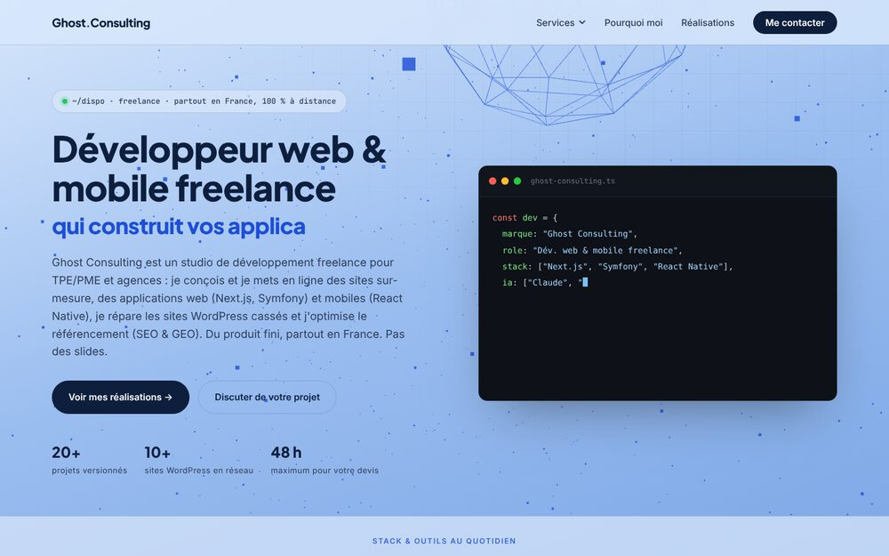

  

> Mon portfolio et mes offres de services, en HTML statique.

   

  

**Statut** — 🟢 En production sur [bakabi.fr](https://bakabi.fr)

---

# Portfolio — bakabi.fr

## Le problème

Un indépendant a besoin d'une vitrine qui charge vite, qu'il peut corriger en deux minutes sans passer par un CMS, et qui se redéploie n'importe où.

## Ce que fait le projet

- Une page par offre : agents IA, audit SEO et GEO, automatisation n8n, infogérance VPS, maintenance WordPress
- Des fiches projets avec captures, un blog et une page de contact
- Un `llms.txt` à la racine, pour que les moteurs de réponse IA sachent quoi citer
- Aucune base de données, aucun build : des fichiers servis tels quels

## Structure

`index.html` et une page par offre · `Projets/` les fiches · `blog/` · `assets/` · `Dockerfile` pour le déploiement

## Lancer le projet

Ouvrir `index.html` dans un navigateur. Pour servir en local : `python -m http.server 8080`.

---

Développé par **Bakari Abidina** · [bakabi.fr](https://bakabi.fr)
